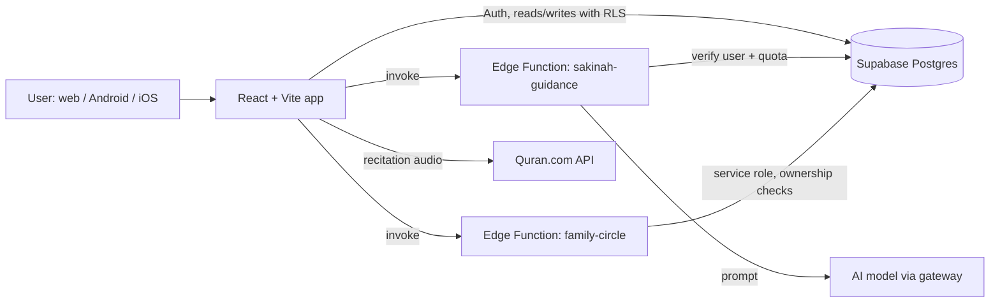

# 🌿 Sakinah — Return to Allah in every moment

**What it is:** a full-stack, AI-powered web and mobile app where a large language model (Claude) helps to connect to Quran with reflections and quranic ayats. 

**How it works:** a React + TypeScript client calls Deno edge functions on Supabase. They authenticate the user, enforce a per-tier daily quota, and prompt the model through a server-side AI gateway to return strictly structured JSON in the user’s language. Data is stored in Postgres with Row Level Security (private journal plus the opt-in Family Circle), and the same codebase ships to Android and iOS with Capacitor.

At *any* point in life: when you're grateful, joyful, anxious, lost, grieving, or simply reflecting. You write what's on your heart, in English or Bengali, and Sakinah answers with a relevant Quranic verse, a prophetic hadith, a "Healing Name of Allah", and a short, friendly reflection that ties them to what you shared. Whether the message is *"Career stress is overwhelming me"* or *"I want to thank Allah for everything"*, the goal is the same: turn the moment, happy or sad, into a connection with the Quran and Sunnah.

**🔗 Live demo:** [sakinah-in-your-heart.vercel.app](https://sakinah-in-your-heart.vercel.app)

> Built end to end as a solo project: product design, React front end, serverless back end, database schema with row-level security, AI integration, and a native mobile wrapper.

---

## ✨ Features

| | |
|---|---|
| **Guided reflection** | Type "What is on your heart today?", whether it's worry, gratitude, joy or grief, and get a verse, hadith, Name of Allah and reflection in one response. |
| **Bilingual** | Writes back in English or Bengali depending on the language of the message. Arabic text uses the Amiri typeface and renders right to left. |
| **Quran recitation** | Play/pause audio for the verse, streamed from the Quran.com API. |
| **Private journal** | Every reflection is saved to a personal, cloud-synced history (private by default). Old browser-only entries are imported automatically on first sign-in. |
| **Family Circle** | Create a family of up to 5, invite members by link, and choose entry by entry what to share. |
| **Accounts** | Email/password sign-up, forgot/reset password, change email and password. |
| **Free tier + paywall** | 3 free reflections per day, tracked server-side. Paid tiers have unlimited use. |
| **Mobile apps** | Android and iOS projects generated with Capacitor from the same codebase. |
| **Share** | One-tap copy of the full guidance to share with a friend. |

---

## 🧱 Tech stack

**Front end**
- React 18 + TypeScript, built with Vite
- Tailwind CSS with shadcn/ui (Radix UI primitives)
- Framer Motion for the loading animation and card transitions
- React Router (protected routes, invite deep links)
- Custom hooks for data access (auth, history, family) on top of the typed Supabase client
- Lucide icons; Google Fonts (Amiri, Inter)

**Back end** (TypeScript on Deno)
- Supabase: Postgres, Auth, Row Level Security, Edge Functions (Deno)
- AI model reached through an AI gateway from a server-side function, so no model keys ever reach the browser

**Mobile & tooling**
- Capacitor 8 (Android + iOS)
- Vitest + Testing Library (front end), Deno test (edge functions)
- ESLint, Drizzle (schema and SQL migrations)

---

## 🏗️ Architecture



### Front end (`src/`)

```
src/
├── pages/          Index (main flow), Auth, ForgotPassword, ResetPassword,
│                   Account, Invite, NotFound
├── components/     ResultCard, HadithCard, LoadingAnimation, HistoryDrawer,
│                   FamilySection, Paywall, and shadcn/ui primitives
├── hooks/          use-auth (session context), use-reflection-history,
│                   use-family, use-toast, use-mobile
├── integrations/   Typed Supabase client + generated DB types
└── lib/            Utilities
```

- **State and data flow:** `AuthProvider` exposes the session to the app; `ProtectedRoute` guards `/` and `/account`. The main page is a small state machine (input → loading → result / limit reached) animated with `AnimatePresence`.
- **Hooks as the data layer:** `useReflectionHistory` and `useFamily` wrap all Supabase reads and writes, keeping components presentational.
- **Typed end to end:** database types are generated from the schema and used by the Supabase client.

### Back end (`supabase/functions/`)

**`sakinah-guidance`**: the AI endpoint
1. Verifies the caller's JWT and loads their profile (tier, today's usage).
2. Computes the daily quota (`quota.ts`): free users get 3 per day, resetting at the UTC day boundary; `plus` and `family` tiers are unlimited. A `status` action returns remaining reflections without calling the AI.
3. Validates input (non-empty, max 4,000 characters).
4. Calls the model with a structured system prompt that returns a single JSON object: Name of Allah, verse, translation, hadith (with narrator and source), and reflection. It also detects the user's language and answers in it.
5. Parses the response, increments the usage counter using the service-role client, and returns the result along with the updated quota.
6. Maps upstream failures (rate limit, billing, parse errors) to clear HTTP responses.

**`family-circle`**: family management API (`status`, `create`, `invite`, `revoke`, `remove`, `leave`, `delete`, `accept`)
- Enforces ownership rules server-side: only owners invite, revoke or remove; owners can't be removed; owners must delete rather than leave.
- Max 5 members, counting pending invitations.
- Invitations use an unguessable UUID token, expire after 7 days, and can only be accepted by the signed-in user whose email matches the invite.
- One family per user (unique constraint).

### Data model (`drizzle/`)

| Table | Purpose |
|---|---|
| `profiles` | One row per user: subscription tier, daily reflection count, last reset date |
| `reflections` | Saved guidance (query, verse, translation, hadith, Name of Allah, reflection) with `is_shared_with_family`, default `false` |
| `families` | Family name, owner, member cap |
| `family_members` | Membership and role (`owner` / `member`); a user can belong to one family |
| `family_invitations` | Invite token, target email, status, expiry |

**Security is enforced in the database with Row Level Security:**
- Users can only read, insert, update and delete their own reflections.
- A family member can read a teammate's reflection **only if** it has been explicitly shared and both users are in the same family (`same_family()`).
- Family and invitation policies use `SECURITY DEFINER` helper functions (`is_family_member`, `is_family_owner`) to avoid recursive policy checks.
- Privileged operations such as quota updates and family mutations run in edge functions with the service role, after validating the caller.

---

## 🚀 Getting started

**Prerequisites:** Node.js 18+, a Supabase project, and the Supabase CLI.

```bash
git clone https://github.com/salwacynthia/sakinah-in-your-heart.git
cd sakinah-in-your-heart
npm install
```

Create a `.env` file:

```env
VITE_SUPABASE_URL=<your-supabase-url>
VITE_SUPABASE_PUBLISHABLE_KEY=<your-supabase-anon-key>
VITE_SUPABASE_PROJECT_ID=<your-project-id>
```

Apply the schema in `drizzle/migrations/` to your Supabase database, then deploy the functions and set their secrets:

```bash
supabase functions deploy sakinah-guidance
supabase functions deploy family-circle
```

Run the app:

```bash
npm run dev        # http://localhost:8080
npm run build      # production build
npm run test       # front-end tests (Vitest)
npm run lint
```

**Mobile (Capacitor):**

```bash
npm run build
npx cap sync
npx cap open android   # or: npx cap open ios
```

---

## 🧪 Testing

- `src/test/`: Vitest + Testing Library setup
- `supabase/functions/sakinah-guidance/quota_test.ts`: Deno tests for the daily-quota logic (day rollover, tier handling, limit reached)

---

## 🛡️ Design notes & responsible AI

Sakinah deals with personal and religious content, for moments of ease as much as moments of difficulty, so the design leans on a few principles:

- **Privacy first:** reflections are private by default; sharing with family is opt-in per entry and enforced by RLS, not just the UI.
- **Server-side secrets and limits:** model access and quota checks live in edge functions, never in the client.
- **Tone:** the prompt asks for a warm, conversational voice ("a kind friend, not a textbook") that fits the mood of the message, comforting in hard times and celebratory in joyful ones, and restricts hadith to the six major collections.

## 🗺️ Roadmap

- [ ] Payment integration for the paid tiers (UI is in place)
- [ ] Source verse and hadith text from verified datasets, with the model choosing only the reference, to eliminate any chance of misquotation
- [ ] Mood-aware responses, including crisis-aware handling that points to human support when a message signals serious distress
- [ ] Atomic quota increments to prevent concurrent-request overuse
- [ ] Response schema validation (Zod) in the edge function, and typed form validation on the client
- [ ] Language selector and fully localized UI labels
- [ ] Email delivery for family invitations
- [ ] Expanded automated test coverage

---

## 📄 License

Personal portfolio project. Please contact the author before reusing the code or content.

## 👤 Author

**salwacynthia**: [GitHub](https://github.com/salwacynthia)
